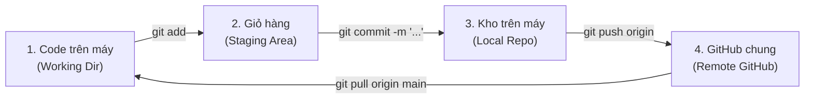

# QUY TRÌNH LÀM VIỆC VỚI GIT & GITHUB (GIT_WORKFLOW.MD)
> **Dành cho đồ án nhóm 4 người — Lập trình C# WinForms (.NET 10)**  
> *Đặc biệt thiết kế cho phong cách "Vibe-Code" (dùng AI hỗ trợ viết code) để không bao giờ bị đụng độ (Merge Conflict) hay hỏng giao diện.*

---

## PHẦN 1: TƯ DUY CỐT LÕI VỀ GIT (DÀNH CHO NGƯỜI MỚI)

Để không bị bối rối, hãy hình dung Git giống như quy trình gửi hàng:
- **1. Thư mục làm việc (Working Directory):** Bàn làm việc của bạn (nơi bạn đang gõ code hoặc AI đang sinh code).
- **2. Giỏ hàng chuẩn bị gửi (Staging Area):** Lệnh `git add` nhặt các file bạn đã làm xong bỏ vào thùng hàng.
- **3. Kho lưu trữ trên máy bạn (Local Repository):** Lệnh `git commit` đóng băng thùng hàng và dán nhãn ghi chú (*"Tôi vừa làm xong chức năng X"*).
- **4. Đám mây chung của nhóm (GitHub Remote):** Lệnh `git push` tải thùng hàng từ máy bạn lên GitHub để cả nhóm cùng thấy.



### Mô hình nhánh (Branch) của 4 thành viên:
- Nhánh `main`: **Nhánh thiêng liêng**, luôn luôn chạy được, không có lỗi đỏ. Chỉ nhóm trưởng mới gộp code vào đây.
- Mỗi người làm việc trên 1 nhánh riêng biệt:
  - Thành viên 1: `member1-books`
  - Thành viên 2: `member2-import`
  - Thành viên 3: `member3-borrow`
  - Thành viên 4: `member4-fine-stats`

---

## PHẦN 2: THIẾT LẬP BAN ĐẦU (CHỈ LÀM 1 LẦN DUY NHẤT Ở NGÀY ĐẦU TIÊN)

### 👤 Bước 2.1: Dành cho Nhóm trưởng (Bạn)
- [x] **1. Đưa dự án gốc lên GitHub:**
  - Dự án đã được đưa lên repo chính thức: [Call-me-Ren/C-_Project](https://github.com/Call-me-Ren/C-_Project)
  - Các lệnh khởi tạo và liên kết đã hoàn tất:
    ```bash
    git branch -M main
    git remote add origin https://github.com/Call-me-Ren/C-_Project.git
    git push -u origin main
    ```
- [ ] **2. Thêm 3 thành viên vào dự án:**
  - Vào GitHub Repo $\rightarrow$ **Settings** $\rightarrow$ **Collaborators** $\rightarrow$ **Add people** (nhập username GitHub của 3 bạn trong nhóm để cấp quyền).

---

### 👥 Bước 2.2: Dành cho 3 thành viên còn lại (Máy của bạn A, B, C)
- [ ] **1. Cài đặt định danh Git trên máy (chỉ gõ 1 lần):**
  ```bash
  git config --global user.name "Nguyen Van A"
  git config --global user.email "a@student.sgu.edu.vn"
  ```
- [ ] **2. Tải toàn bộ dự án về máy:**
  - Mở VS Code hoặc PowerShell tại thư mục muốn lưu code:
    ```bash
    git clone https://github.com/Call-me-Ren/C-_Project.git
    cd C-_Project
    ```
- [ ] **3. Chạy CSDL trên SQL Server Management Studio (SSMS) ở máy mình:**
  - Mở SSMS trên máy cá nhân $\rightarrow$ mở file `SQL/QLThuVien1.sql` (bản chuẩn mới nhất có đủ 17 bảng, dữ liệu mẫu và không bị trigger đè) bấm **F5 (Execute)**.
  - *(Lưu ý: Nếu máy đã chạy DB cũ từ trước, chỉ cần mở file `SQL/Patch_0.3_CapNhatCSDL.sql` và bấm **F5** để cập nhật mà không phải xóa database).*
- [ ] **4. Tạo và chuyển sang nhánh riêng của mình:**
  - Thành viên 2: `git checkout -b member2-import`
  - Thành viên 3: `git checkout -b member3-borrow`
  - Thành viên 4: `git checkout -b member4-fine-stats`

---

## PHẦN 3: 5 BƯỚC VÀNG LÀM VIỆC HÀNG NGÀY (QUY TRÌNH CHUẨN)

Mỗi khi ngồi vào máy tính để bắt đầu code hoặc vibe-code cùng AI, hãy đi đúng 5 bước sau:

### 🔹 Bước 1: Luôn cập nhật code mới nhất từ `main` về trước khi làm
Trước khi gõ bất kỳ dòng code nào, phải kéo những gì người khác đã làm về máy:
```bash
# 1. Chuyển về nhánh main để kéo code mới
git checkout main
git pull origin main

# 2. Chuyển lại về nhánh của mình và đồng bộ code mới vào nhánh mình
git checkout <ten-nhanh-cua-ban>
git merge main
```

### 🔹 Bước 2: Code hoặc Vibe-Code cùng AI & Bắt buộc kiểm tra Build
- Bạn yêu cầu AI viết 1 tính năng nhỏ (ví dụ: tạo `DTO` và `DAO` cho bảng `TacGia`).
- **QUY TẮC SỐNG CÒN:** Trước khi chuẩn bị commit, luôn chạy lệnh:
  ```bash
  dotnet build src/QLThuVien.sln
  ```
- **Nếu báo `Build succeeded (0 Error)`:** Tiếp tục bước 3.
- **Nếu báo lỗi đỏ (`Build FAILED`):** Phải sửa hết lỗi đỏ ngay tại chỗ. **TUYỆT ĐỐI CẤM commit khi code còn lỗi build!**

### 🔹 Bước 3: Xem lại các file vừa thay đổi bằng `git status`
Gõ lệnh:
```bash
git status
```
- Màn hình sẽ hiện danh sách file màu đỏ (những file bạn vừa sửa hoặc tạo mới).
- Nhìn lướt qua xem có file nào lạ không (ví dụ: vô tình sửa file của người khác hoặc file tạm).

### 🔹 Bước 4: Nhặt từng file cụ thể vào giỏ hàng (`git add`)
> [!CAUTION]
> **TẬP THÓI QUEN: KHÔNG GÕ `git add .` MỘT CÁCH NHẮM MẮT!**
> Vì gõ `git add .` sẽ nhặt luôn cả file `MyConnection.cs` (nếu bạn lỡ đổi tên Server trên máy bạn) hoặc các file linh tinh khác.

- **Hãy add từng file hoặc từng thư mục cụ thể bạn vừa làm:**
  ```bash
  # Ví dụ bạn vừa làm xong Tác giả:
  git add src/QLThuVien/DTO/TacGiaDTO.cs
  git add src/QLThuVien/DAO/TacGiaDAO.cs
  git add src/QLThuVien/BUS/TacGiaBUS.cs
  git add src/QLThuVien/GUI/frmTacGia.cs
  git add src/QLThuVien/GUI/frmTacGia.Designer.cs
  ```

### 🔹 Bước 5: Đóng gói và đẩy lên GitHub (`git commit` & `git push`)
- **Đóng gói commit** kèm lời nhắn rõ ràng (bằng tiếng Việt hoặc tiếng Anh ngắn gọn):
  ```bash
  git commit -m "feat: hoan thanh them sua xoa TacGia du 3 lop"
  ```
- **Đẩy lên GitHub:**
  ```bash
  git push origin <ten-nhanh-cua-ban>
  ```
  *(Ví dụ: `git push origin member1-books`)*

---

## PHẦN 4: BỘ QUY TẮC "VIBE-CODE KHÔNG ĐỤNG ĐỘ" CHO 4 NGƯỜI

Khi cả 4 thành viên cùng dùng AI (Antigravity, Cursor, ChatGPT, Copilot...) để sinh code, nếu không có quy tắc dưới đây, đồ án chắc chắn sẽ thành "mớ bòng bong":

### 🚫 Quy tắc 1: 3 File "CẤM ĐỊA" — Không ai được tự ý đẩy đè lên GitHub!
1. **`src/QLThuVien/DAO/MyConnection.cs`:**
   - Mỗi máy có thể có tên Server khác nhau (máy dùng `.`, máy dùng `.\SQLEXPRESS`, máy dùng tên riêng).
   - **Cách giải quyết:** Giữ nguyên chuỗi chuẩn `Server=.;Database=QLThuVien;Integrated Security=True;TrustServerCertificate=True;` trên GitHub. Nếu trên máy bạn cần sửa để chạy, trước khi `git add` hãy hoàn trả lại file này bằng lệnh:
     ```bash
     git checkout -- src/QLThuVien/DAO/MyConnection.cs
     ```
2. **`src/QLThuVien/GUI/frmMain.Designer.cs` & `frmMain.cs`:**
   - File này chứa giao diện thanh Menu bên trái. Nếu cả 4 người cùng mở kéo thả nút bấm thì Git sẽ bị xung đột nát bét!
   - **Cách giải quyết:** **Chỉ duy nhất Nhóm trưởng (Thành viên 1)** được sửa `frmMain`. Ba thành viên còn lại chỉ thiết kế form chức năng của riêng mình (ví dụ: `frmDocGia`, `frmPhieuNhap`). Khi gộp nhánh, Nhóm trưởng sẽ thêm nút mở form vào menu chính.
3. **`src/QLThuVien/Program.cs`:**
   - Nếu bạn muốn chạy thử form của mình khi bấm F5, bạn có thể vào `Program.cs` sửa tạm `Application.Run(new frmDocGia());`. Nhưng khi commit, hãy trả lại `Application.Run(new frmMain());`.

---

### 🛡️ Quy tắc 2: Phân chia lãnh thổ File rõ ràng (File Ownership)
- **Nguyên tắc "Đất ai nấy ở":**
  - Thành viên làm `DocGia` thì chỉ được tạo và sửa các file bắt đầu bằng `DocGia` (`DocGiaDTO.cs`, `DocGiaDAO.cs`, `DocGiaBUS.cs`, `frmDocGia.cs`).
  - Tuyệt đối không mở file của người khác sửa trộm.
- **Nếu cần dùng dữ liệu của người khác:**
  - Ví dụ: Làm `PhieuMuon` cần kiểm tra xem cuốn sách có ai mượn chưa. Hãy gọi hàm có sẵn của `SachBUS`:
    ```csharp
    SachBUS sachBus = new SachBUS();
    // Gọi hàm bạn mình đã viết, KHÔNG tự ý viết lại query vào SachDAO!
    ```

---

### 🏷️ Quy tắc 3: Chuẩn hóa Namespace & Tên lớp (Bắt buộc dùng chung)
Tất cả các thành viên khi viết code hoặc nhờ AI viết phải dùng **chính xác 100%** namespace này:
- `namespace QLThuVien.DTO`
- `namespace QLThuVien.DAO`
- `namespace QLThuVien.BUS`
- `namespace QLThuVien.GUI`

---

### 💬 Quy tắc 4: Mẫu câu lệnh (Prompt) chuẩn để ra lệnh cho AI (Copy dùng ngay)
Khi các thành viên dùng AI để code tính năng của mình, hãy copy đoạn này dán vào đầu câu nhắc cho AI:

> *"Tôi đang làm đồ án Quản lý Thư viện C# WinForms .NET 10 theo mô hình 3 lớp chuẩn: `GUI -> BUS -> DAO` và `DTO`. CSDL là SQL Server kết nối qua class `MyConnection`. Hãy viết cho tôi chức năng [TÊN_CHỨC_NĂNG] tuân thủ đúng các quy tắc sau:
> 1. Namespace phải là `QLThuVien.DTO`, `QLThuVien.DAO`, `QLThuVien.BUS`, `QLThuVien.GUI`.
> 2. Tuyệt đối không viết câu truy vấn SQL ở GUI hay BUS, SQL chỉ nằm ở DAO.
> 3. Trong DAO phải gọi `MyConnection.ExecuteQuery` hoặc `ExecuteNonQuery` có dùng `SqlParameter`.
> 4. Trong BUS phải có `ArrayList` để lưu danh sách và hàm tìm kiếm duyệt trên `ArrayList` (không gọi SELECT xuống DB liên tục).
> 5. Mọi tính toán và kiểm tra trùng mã phải nằm ở lớp BUS."*

---

## PHẦN 5: QUY TRÌNH GỘP CODE (PULL REQUEST TRÊN GITHUB) DÀNH CHO NHÓM TRƯỞNG

Khi một thành viên đã làm xong 1 module và đã test không còn lỗi:

- [ ] **Bước 5.1:** Thành viên đó lên GitHub repo $\rightarrow$ bấm tab **Pull requests** $\rightarrow$ bấm **New pull request**.
- [ ] **Bước 5.2:** Chọn gộp từ nhánh của mình (ví dụ `member2-import`) vào nhánh `main` $\rightarrow$ bấm **Create pull request** kèm mô tả ngắn.
- [ ] **Bước 5.3 (Nhóm trưởng duyệt):**
  - Nhóm trưởng lên GitHub mở Pull Request đó ra xem mục **Files changed**:
    - [x] Có bị sửa nhầm file `MyConnection.cs` không?
    - [x] Có bị sửa nhầm `frmMain.Designer.cs` không?
    - [x] Các file có đúng chuẩn 3 lớp không?
  - Nếu tất cả chuẩn: Bấm nút xanh **Merge pull request** $\rightarrow$ **Confirm merge**.
- [ ] **Bước 5.4:** Tất cả thành viên (kể cả nhóm trưởng) về máy mình gõ:
  ```bash
  git checkout main
  git pull origin main
  ```
  Để lấy toàn bộ phần code vừa được gộp về máy mình!

---

## PHẦN 6: HƯỚNG DẪN XỬ LÝ KHI BỊ XUNG ĐỘT (MERGE CONFLICT)

Nếu chẳng may 2 người cùng sửa chung 1 dòng code, Git sẽ báo:
`CONFLICT (content): Merge conflict in ...`

Đừng hoảng loạn! Hãy làm đúng 4 bước sau:

- [ ] **Bước 1:** Mở **VS Code (bản màu xanh)** lên. Bạn sẽ thấy file bị xung đột hiện chữ **`C`** màu đỏ hoặc cam.
- [ ] **Bước 2:** Bấm mở file đó ra. Bạn sẽ thấy đoạn code lạ mắt dạng:
  ```csharp
  <<<<<<< HEAD (Code hiện tại trên máy bạn)
  string server = ".";
  =======
  string server = @".\SQLEXPRESS";
  >>>>>>> main (Code mới kéo về từ GitHub)
  ```
- [ ] **Bước 3:** Ngay phía trên dòng đó, VS Code hiển thị 4 nút bấm tiện lợi:
  - **Accept Current Change:** Giữ lại code của máy bạn.
  - **Accept Incoming Change:** Lấy code mới kéo về từ GitHub.
  - **Accept Both Changes:** Giữ cả 2 đoạn code.
  - 👉 Hãy bấm chọn phương án đúng (hoặc tự tay xóa các dòng `<<<<<<<`, `=======`, `>>>>>>>` đi và sửa lại cho đúng).
- [ ] **Bước 4:** Chạy thử `dotnet build src/QLThuVien.sln` để đảm bảo code hết lỗi đỏ, sau đó lưu lại và commit:
  ```bash
  git add <file-vua-sua-xong>
  git commit -m "fix: resolve merge conflict"
  ```

> [!TIP]
> **Nút bấm "HỦY BỎ KHẨN CẤP" khi lỡ tay làm hỏng lúc merge:**  
> Nếu bạn đang giải quyết xung đột mà thấy rối quá, muốn quay lại y nguyên trạng thái trước khi merge:
> ```bash
> git merge --abort
> ```
> Mọi thứ sẽ lập tức trở lại bình thường như chưa hề có cuộc merge!

---

## PHẦN 7: BẢNG CỨU HỘ NHANH (CHEAT SHEET LỆNH GIT HAY DÙNG NHẤT)

| Lệnh | Ý nghĩa & Khi nào dùng? |
| :--- | :--- |
| `git status` | **Xem tình trạng:** Đang ở nhánh nào, có file nào vừa sửa chưa lưu không. (Nên gõ liên tục!). |
| `git checkout -b <ten-nhanh>` | **Tạo nhánh mới:** Tạo và nhảy sang nhánh mới ngay lập tức. |
| `git checkout <ten-nhanh>` | **Chuyển nhánh:** Nhảy qua lại giữa các nhánh (ví dụ nhảy về `main`). |
| `git pull origin main` | **Kéo code mới:** Lấy code mới nhất từ nhánh `main` trên GitHub về máy mình. |
| `git add <duong-dan-file>` | **Bỏ vào giỏ:** Chọn đúng file đã hoàn thành để chuẩn bị commit. |
| `git commit -m "loi-nhan"` | **Đóng thùng:** Lưu lịch sử thay đổi trên máy kèm lời giải thích. |
| `git push origin <ten-nhanh>` | **Đẩy lên mây:** Tải code từ máy mình lên nhánh trên GitHub. |
| `git diff` | **Soi lỗi:** Xem chi tiết bạn vừa thêm bớt dòng code nào so với bản cũ. |
| `git checkout -- <file>` | **Hoàn tác:** Hủy toàn bộ thay đổi vừa sửa trên 1 file (quay về bản sạch ban đầu). |
| `git merge --abort` | **Cứu hộ khẩn cấp:** Hủy lệnh merge khi gặp xung đột không biết xử lý thế nào. |
