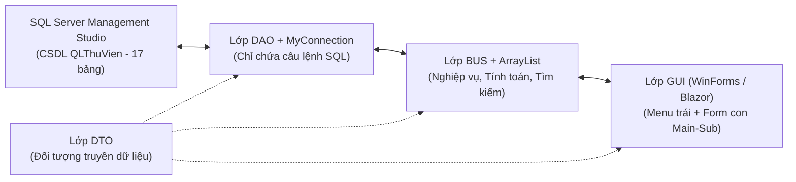

# KẾ HOẠCH TRIỂN KHAI ĐỒ ÁN TỪ A → Z (PLAN.MD)
**Đề tài:** Phần mềm Quản lý Thư viện — Học phần Lập trình C# (GVHD: Cô Phùng Thái Thiên Trang)

---

## PHẦN 1: CÔNG CỤ & MÔI TRƯỜNG LÀM VIỆC

Để quá trình làm đồ án trơn tru và không bị chồng chéo công cụ, mỗi phần mềm sẽ đảm nhận đúng nhiệm vụ sau:

| Công cụ | Vai trò cụ thể trong đồ án |
| :--- | :--- |
| **1. SQL Server Management Studio (SSMS)** | - Chạy script khởi tạo CSDL `QLThuVien` (16 bảng gốc + 1 bảng `ThamSo` = **17 bảng**).<br>- Chạy script cập nhật xóa Trigger tự động, kiểm tra dữ liệu bảng và chụp ảnh sơ đồ Database Diagram cho báo cáo. |
| **2. Visual Studio 2022 (Bản màu tím)** | - Mở file `src/QLThuVien.sln` khi muốn sử dụng **WinForms Designer** (kéo thả giao diện Form, căn chỉnh nút bấm, xem trước bố cục trực quan bằng phím `Shift + F7`). |
| **3. Visual Studio Code (Bản màu xanh) + Antigravity** | - Viết và đọc hiểu từng bước code cho các lớp `DTO`, `DAO`, `BUS`, `GUI`.<br>- Chạy lệnh `dotnet build` và `dotnet run` để kiểm tra lỗi nhanh.<br>- Quản lý phiên bản với Git (commit từng bước nhỏ). |
| **4. GitHub Repository** | - Lưu trữ source code trực tuyến, chia nhánh (`branch`) cho các thành viên và nộp link sản phẩm ở Mục V của báo cáo cuối kỳ. |



---

## PHẦN 2: KẾ HOẠCH THỰC HIỆN TỪNG BƯỚC NHỎ (MICRO-STEPS TỪ ĐẦU ĐẾN CUỐI)

### 🟢 GIAI ĐOẠN 0: CHUẨN BỊ MÔI TRƯỜNG & CƠ SỞ DỮ LIỆU (ĐANG THỰC HIỆN)

- [x] **Bước 0.1 — Khởi tạo Git & Cấu trúc Solution `.NET 10` (Trên VS Code + Antigravity):**
  - Khởi tạo Git repository (`git init`), tạo file `.gitignore`.
  - Tạo Solution `src/QLThuVien.sln` và Project WinForms `src/QLThuVien/QLThuVien.csproj`.
  - Cài đặt thư viện `Microsoft.Data.SqlClient`.
  - Chia sẵn 4 thư mục chuẩn: `DTO/`, `DAO/`, `BUS/`, `GUI/`.
- [x] **Bước 0.2 — Khởi tạo CSDL ban đầu trên SQL Server Management Studio (SSMS):**
  - Mở **SQL Server Management Studio (SSMS)**, kết nối tới Server local.
  - Mở file `requirement_input/team_specs/QLThuVien1.sql` và nhấn **F5 (Execute)** để tạo database `QLThuVien` cùng 16 bảng và dữ liệu mẫu.
- [x] **Bước 0.3 — Cập nhật CSDL để xử lý các điểm mâu thuẫn trên SQL Server Management Studio (SSMS):**
  - **Vì sao cần bước này?** Bạn đã chạy `QLThuVien1.sql` trên SSMS, nhưng cần:
    1. Xóa 2 Trigger tự động (`trg_ChiTietPhieuMuon_Insert` và `trg_ChiTietPhieuMuon_UpdateTraSach`) để khi viết code cộng/trừ tồn kho ở lớp `BUS` **không bị cộng/trừ 2 lần**.
    2. Bổ sung bảng thứ 17 là **`ThamSo`** (theo đúng Yêu cầu số 9 của cô Trang).
    3. Chuyển cột `ThanhTien` của bảng `ChiTietPhieuNhap` từ cột tự tính (`COMPUTED`) thành cột `DECIMAL(18,2)` thường để lớp `BUS` tự tính và lưu xuống.
    4. Mở rộng khóa chính của `ChiTietPhieuPhat` để 1 phiếu phạt có thể phạt nhiều cuốn sách cùng lỗi.
  - **Cách làm trên SQL Server Management Studio (SSMS):** Không cần xóa CSDL cũ! Bạn chỉ cần mở **SSMS** $\rightarrow$ bấm **New Query** $\rightarrow$ dán đoạn lệnh dưới đây vào và nhấn **F5 (Execute)**:
    ```sql
    USE QLThuVien;
    GO

    -- 1. Xóa 2 Trigger tự động để xử lý 100% tồn kho ở lớp BUS (tránh bị trừ 2 lần)
    IF OBJECT_ID('trg_ChiTietPhieuMuon_Insert', 'TR') IS NOT NULL
        DROP TRIGGER trg_ChiTietPhieuMuon_Insert;
    IF OBJECT_ID('trg_ChiTietPhieuMuon_UpdateTraSach', 'TR') IS NOT NULL
        DROP TRIGGER trg_ChiTietPhieuMuon_UpdateTraSach;
    GO

    -- 2. Tạo bảng thứ 17: Bảng ThamSo (Yêu cầu số 9 của Giáo viên)
    IF OBJECT_ID('ThamSo', 'U') IS NULL
    BEGIN
        CREATE TABLE ThamSo (
            MaTS VARCHAR(50) NOT NULL PRIMARY KEY,
            TenTS NVARCHAR(100) NOT NULL,
            GiaTri NVARCHAR(100) NOT NULL
        );

        INSERT INTO ThamSo (MaTS, TenTS, GiaTri) VALUES
        ('SO_SACH_MUON_TOI_DA', N'Số cuốn sách tối đa mỗi lần mượn', '5'),
        ('SO_NGAY_MUON_TOI_DA', N'Số ngày mượn tối đa mặc định', '7'),
        ('TIEN_PHAT_MOI_NGAY', N'Tiền phạt trễ hạn mỗi ngày (VNĐ)', '5000'),
        ('NAM_XB_TOI_THIEU', N'Năm xuất bản tối thiểu hợp lệ', '1900');
    END
    GO

    -- 3. Chuyển cột ThanhTien trong ChiTietPhieuNhap thành cột thường để lớp BUS tự tính
    -- Bước 3.1: Xóa cột tự tính cũ
    IF EXISTS (SELECT 1 FROM sys.computed_columns WHERE name = 'ThanhTien' AND object_id = OBJECT_ID('ChiTietPhieuNhap'))
    BEGIN
        ALTER TABLE ChiTietPhieuNhap DROP COLUMN ThanhTien;
    END
    GO

    -- Bước 3.2: Thêm lại cột ThanhTien là kiểu số DECIMAL thông thường
    IF NOT EXISTS (SELECT 1 FROM sys.columns WHERE name = 'ThanhTien' AND object_id = OBJECT_ID('ChiTietPhieuNhap'))
    BEGIN
        ALTER TABLE ChiTietPhieuNhap ADD ThanhTien DECIMAL(18, 2) NOT NULL DEFAULT 0;
    END
    GO

    -- Bước 3.3: Cập nhật giá trị dữ liệu mẫu
    UPDATE ChiTietPhieuNhap 
    SET ThanhTien = DonGia * SoLuong;
    GO
    ```
- [x] **Bước 0.4 — Xây dựng class `DAO/MyConnection.cs` (Trên VS Code + Antigravity):**
  - Viết class `MyConnection` quản lý chuỗi kết nối tới SQL Server và 3 phương thức dùng chung: `ExecuteQuery` (`SELECT`), `ExecuteNonQuery` (`INSERT/UPDATE/DELETE`), `ExecuteScalar` (lấy 1 giá trị).

---

### 🔵 GIAI ĐOẠN 1: KHUNG GIAO DIỆN CHÍNH (`frmMain`) & MODULE MẪU ĐẦU TIÊN (`TheLoai`)

Mục tiêu của giai đoạn này là làm **1 đường thẳng mẫu thông suốt từ CSDL lên Giao diện** để bạn nắm vững 100% luồng 3 lớp trước khi nhân bản sang các bảng khác.

- [ ] **Bước 1.1 — Viết `DTO/TheLoaiDTO.cs`:**
  - Khai báo thuộc tính `MaTL`, `TenTL`, constructor không tham số và có tham số.
- [ ] **Bước 1.2 — Viết `DAO/TheLoaiDAO.cs`:**
  - Gọi `MyConnection` thực hiện 4 hàm: `DocDSTheLoai()`, `Them(TheLoaiDTO tl)`, `Sua(TheLoaiDTO tl)`, `Xoa(string maTL)` và `KiemTraDangSuDung(string maTL)` (kiểm tra xem `DauSach` có đang tham chiếu không trước khi xóa).
- [ ] **Bước 1.3 — Viết `BUS/TheLoaiBUS.cs` (Trọng tâm cô sẽ hỏi):**
  - Khai báo `public ArrayList dstl_arr = new ArrayList();` (hoặc `List<TheLoaiDTO>`).
  - Hàm `DocDSTheLoai()`: Gọi `DAO` lấy dữ liệu nạp vào `dstl_arr`.
  - Hàm `KiemTraMaDuyNhat(string maTL)`: Duyệt trên `dstl_arr` kiểm tra trùng mã.
  - Hàm `Them`, `Sua`, `Xoa`: Kiểm tra hợp lệ $\rightarrow$ Gọi `DAO` cập nhật xuống SQL Server $\rightarrow$ Cập nhật ngay trên `dstl_arr`.
  - Hàm `TimKiem(string tuKhoa)`: Lọc trực tiếp trên `dstl_arr` (tuyệt đối không gọi `SELECT` xuống CSDL).
- [ ] **Bước 1.4 — Thiết kế `GUI/frmTheLoai.cs`:**
  - Gồm các ô nhập `txtMaTL`, `txtTenTL`, ô tìm kiếm `txtTimKiem`, các nút `Thêm`, `Sửa`, `Xóa`, `Làm mới`, `Tìm kiếm`, và bảng danh sách `lvTheLoai` / `dgvTheLoai`.
- [ ] **Bước 1.5 — Thiết kế Màn hình chính `GUI/frmMain.cs` (Yêu cầu 13 của GV):**
  - Bố cục Desktop: Thanh Menu bên trái (`pnlMenuLeft`) chứa các nút điều hướng, phần tiêu đề phía trên (`pnlHeader`), và vùng chứa Form con ở giữa (`pnlContent`).
  - Viết hàm nhúng Form con (`OpenChildForm(Form childForm)`) để khi bấm nút *"Quản lý Thể loại"* ở menu trái thì `frmTheLoai` hiện gọn bên trong `pnlContent`.

---

### 🟣 GIAI ĐOẠN 2: NHÓM CHỨC NĂNG DANH MỤC NỀN & CẤU HÌNH (7 BẢNG)

Nhân bản theo đúng khuôn mẫu chuẩn của `TheLoai` cho 7 bảng danh mục độc lập:

- [ ] **Bước 2.1 — Module Nhà xuất bản (`NhaXuatBan`):**
  - Tạo `NhaXuatBanDTO`, `NhaXuatBanDAO`, `NhaXuatBanBUS` (`ArrayList`), `frmNhaXuatBan`.
  - Ràng buộc xóa: Không cho xóa nếu đã có `DauSach` thuộc NXB đó.
- [ ] **Bước 2.2 — Module Tác giả (`TacGia`):**
  - Tạo `TacGiaDTO`, `TacGiaDAO`, `TacGiaBUS` (`ArrayList`), `frmTacGia` (`MaTG`, `HoLot`, `TenTG`, `NgaySinh`, `SDT`).
- [ ] **Bước 2.3 — Module Nhà cung cấp (`NhaCungCap`):**
  - Tạo `NhaCungCapDTO`, `NhaCungCapDAO`, `NhaCungCapBUS` (`ArrayList`), `frmNhaCungCap`.
- [x] **Bước 2.4 — Module Loại độc giả (`LoaiDocGia`):**
  - Tạo `LoaiDocGiaDTO`, `LoaiDocGiaDAO`, `LoaiDocGiaBUS` (`ArrayList`), `frmLoaiDocGia`.
- [ ] **Bước 2.5 — Module Nhân viên (`NhanVien`):**
  - Tạo `NhanVienDTO`, `NhanVienDAO`, `NhanVienBUS` (`ArrayList`), `frmNhanVien` (`MaNV`, `HoLot`, `TenNV`, `ChucVu`).
- [ ] **Bước 2.6 — Module Quy định phạt (`QuyDinhPhat`):**
  - Tạo `QuyDinhPhatDTO`, `QuyDinhPhatDAO`, `QuyDinhPhatBUS`, `frmQuyDinhPhat` (`MaQD`, `TenQD`, `LoaiPhat`, `CachTinh`, `DonViTinh`, `MucPhat >= 0`).
- [ ] **Bước 2.7 — Module Bảng Tham Số (`ThamSo` — Yêu cầu số 9 của GV):**
  - Tạo `ThamSoDTO`, `ThamSoDAO`, `ThamSoBUS`, `frmThamSo` để xem và cập nhật các hằng số hệ thống (`SO_SACH_MUON_TOI_DA`, `SO_NGAY_MUON_TOI_DA`, `TIEN_PHAT_MOI_NGAY`...).

---

### 🟡 GIAI ĐOẠN 3: NHÓM CHỨC NĂNG CỐT LÕI (ĐẦU SÁCH, CUỐN SÁCH, ĐỘC GIẢ) & NÚT TÌM KIẾM `...`

- [ ] **Bước 3.1 — Xây dựng Form Popup Tìm kiếm dùng chung `frmTimKiemPopup.cs` (Yêu cầu 4 của GV):**
  - Khai báo biến `public static string SelectedID = "";` và `public static string SelectedName = "";`.
  - Khi người dùng bấm nút `...` cạnh ô Mã (trên các form Đầu sách, Phiếu nhập, Phiếu mượn...), `frmTimKiemPopup` bật lên cho phép gõ tên lọc nhanh, click 1 dòng $\rightarrow$ gán mã vào `SelectedID` $\rightarrow$ tự đóng form và điền mã + tên về form chính.
- [x] **Bước 3.2 — Module Quản lý Độc giả (`DocGia`):**
  - Tạo `DocGiaDTO`, `DocGiaDAO`, `DocGiaBUS`, `frmDocGia`.
  - Có nút `...` (hoặc ComboBox) chọn `MaLDG`.
  - Có bảng phụ bên dưới hiển thị **Lịch sử mượn - trả sách** của độc giả đang được chọn.
- [ ] **Bước 3.3 — Module Quản lý Đầu sách & Cuốn sách (`DauSach` & `Sach` — Form Main-Sub 1-N):**
  - Tạo `DauSachDTO/DAO/BUS` và `SachDTO/DAO/BUS`.
  - Thiết kế `frmDauSach`:
    - **Phần Main (Trên/Trái):** Quản lý `DauSach` (`MaDauSach`, `TenSach`, `NamXB`, `DonGia`, nút `...` chọn `MaTL`, `MaTG`, `MaNXB`). Các ô `SoLuong`, `SLChoMuon`, `SLConLai` để chế độ **chỉ xem (`ReadOnly = true`)** (Yêu cầu 7 của GV).
    - **Phần Sub (Dưới/Phải):** Khi click 1 dòng `DauSach` ở bảng trên $\rightarrow$ bảng dưới hiển thị ngay toàn bộ các cuốn `Sach` vật lý (`MaSach`, `TinhTrang`, `ViTri`) thuộc đầu sách đó; cho phép thêm/sửa vị trí và tình trạng từng cuốn sách.

---

### 🟠 GIAI ĐOẠN 4: NHÓM GIAO DỊCH 1-N (NHẬP SÁCH, MƯỢN - TRẢ SÁCH, PHIẾU PHẠT)

Đây là phần quan trọng nhất về nghiệp vụ tính toán ở lớp `BUS` và liên kết 2 bảng (Main-Sub) mà cô sẽ hỏi kỹ khi chấm.

- [ ] **Bước 4.1 — Module Quản lý Nhập sách (`PhieuNhap` & `ChiTietPhieuNhap` — Form Main-Sub 1-N):**
  - Tạo `PhieuNhapDTO/DAO/BUS` và `ChiTietPhieuNhapDTO/DAO/BUS`.
  - Thiết kế `frmPhieuNhap`:
    - **Bảng Master (`lvPhieuNhap`):** Hiển thị danh sách phiếu nhập (`MaPN`, `MaNCC`, `MaNV`, `NgayNhap`, `TongTien`).
    - **Bảng Detail (`lvChiTietPhieuNhap`):** Click 1 dòng `PhieuNhap` $\rightarrow$ hiện toàn bộ dòng `ChiTietPhieuNhap` (`MaPN`, `MaDauSach`, `DonGia`, `SoLuong`, `ThanhTien`).
    - **Nghiệp vụ tại `PhieuNhapBUS` (Yêu cầu 5, 6, 7 của GV):**
      - Chọn `MaDauSach` bằng nút `...` $\rightarrow$ tự hiện `TenSach` và `DonGia` (chỉ xem).
      - Nhập `SoLuong` $\rightarrow$ hàm ở `BUS` tự tính `ThanhTien = DonGia * SoLuong` và cộng dồn vào `PhieuNhap.TongTien`.
      - Khi lưu chi tiết phiếu nhập: `BUS` gọi `DauSachBUS` **tăng `SoLuong` và `SLConLai` thêm đúng bằng `SoLuong` nhập**, đồng thời tự động sinh các mã cuốn sách vật lý tương ứng vào bảng `Sach`!
- [x] **Bước 4.2 — Module Quản lý Mượn sách (`PhieuMuon` & `ChiTietPhieuMuon` — Form Main-Sub 1-N):**
  - Tạo `PhieuMuonDTO/DAO/BUS` và `ChiTietPhieuMuonDTO/DAO/BUS`.
  - Thiết kế `frmMuonTraSach`:
    - **Bảng Master (`lvPhieuMuon`):** `MaPM`, `MaDocGia` (chọn qua nút `...`), `MaNV`, `NgayMuon`, `HanTra` (tự động cộng số ngày mượn tối đa lấy từ bảng `ThamSo`).
    - **Bảng Detail (`lvChiTietPhieuMuon`):** Click 1 dòng `PhieuMuon` $\rightarrow$ hiện các cuốn sách mượn (`MaPhieuMuon`, `MaSach`, `TinhTrang`, `NgayThucTra`).
    - **Nghiệp vụ Mượn sách tại `PhieuMuonBUS`:**
      - Kiểm tra số sách độc giả đang mượn có vượt quá `SO_SACH_MUON_TOI_DA` (trong bảng `ThamSo`) không.
      - Kiểm tra cuốn sách `MaSach` có đang ở trạng thái sẵn sàng cho mượn và `DauSach.SLConLai > 0` không.
      - Khi thêm chi tiết mượn: **Giảm `DauSach.SLConLai` đi 1, tăng `DauSach.SLChoMuon` lên 1**, cập nhật `Sach.TinhTrang = N'Đang mượn'`.
- [x] **Bước 4.3 — Nghiệp vụ Trả sách (Tích hợp trên `frmMuonTraSach`):**
  - Chọn dòng sách đang mượn trong bảng chi tiết $\rightarrow$ bấm nút **"Trả sách"**:
    - Ghi nhận `NgayThucTra = DateTime.Now` và tình trạng sách khi trả (*Tốt / Hư hỏng / Mất*).
    - **Nghiệp vụ tại `BUS`:** Nếu sách trả bình thường $\rightarrow$ **Tăng `DauSach.SLConLai` lên 1, giảm `DauSach.SLChoMuon` đi 1**, đổi `Sach.TinhTrang = N'Tốt'`.
    - Kiểm tra nếu `NgayThucTra > HanTra` (trả trễ) hoặc sách bị *Hư hỏng / Mất* $\rightarrow$ tự động tính `SoNgayTre = (NgayThucTra - HanTra).Days` và mở nhanh sang chức năng lập Phiếu phạt!
- [ ] **Bước 4.4 — Module Quản lý Phiếu phạt (`PhieuPhat` & `ChiTietPhieuPhat` — Form Main-Sub 1-N):**
  - Tạo `PhieuPhatDTO/DAO/BUS` và `ChiTietPhieuPhatDTO/DAO/BUS`.
  - Thiết kế `frmPhieuPhat`:
    - **Bảng Master (`lvPhieuPhat`):** `MaPhieuPhat`, `MaDocGia`, `MaPhieuMuon`, `MaNV`, `NgayLap`, `TrangThai` (*Chưa thanh toán / Đã thanh toán*), `TongTienPhat` (chỉ xem).
    - **Bảng Detail (`lvChiTietPhieuPhat`):** `MaPhieuPhat`, `MaQD`, `MaSach`, `DonGia`, `SoNgayTre`, `GhiChu`, `TienPhat` (chỉ xem).
    - **Nghiệp vụ tính phạt tại `PhieuPhatBUS`:**
      - Nếu chọn `QD01` (Trả trễ): `TienPhat = SoNgayTre * MucPhat` (5.000đ/ngày).
      - Nếu chọn `QD02` (Hư hỏng): `TienPhat = MucPhat` cố định (30.000đ).
      - Nếu chọn `QD03` (Làm mất sách): `TienPhat = DonGiaSach * MucPhat` (100% giá bìa lấy từ `DauSach.DonGia`).
      - Tự động tính tổng `PhieuPhat.TongTienPhat = SUM(ChiTietPhieuPhat.TienPhat)`.

---

### 🔴 GIAI ĐOẠN 5: TÌM KIẾM NÂNG CAO, THỐNG KÊ 3 BẢNG QUÝ, EXCEL & REPORT PDF

- [ ] **Bước 5.1 — Chức năng Tìm kiếm nâng cao (Yêu cầu 8 của GV):**
  - Tích hợp bộ lọc nâng cao trên Form Đầu sách, Phiếu nhập, Phiếu mượn:
  - Cho phép chọn nhiều điều kiện kết hợp toán tử `AND`, `OR`, `NOT` và các phép so sánh `>`, `<`, `>=`, `<=`, `<>`, `=` lọc trên `ArrayList` trong lớp `BUS` (Ví dụ: Lọc đầu sách theo khoảng giá `DonGia >= TuGia AND DonGia <= DenGia`, năm xuất bản, thể loại...).
- [ ] **Bước 5.2 — Module Thống kê tổng hợp & 3 Bảng chéo theo Quý (Yêu cầu 10 của GV):**
  - Tạo `ThongKeBUS.cs` và `frmThongKe.cs` gồm các tab:
    1. **Thống kê Thu - Chi tổng hợp:** Tổng thu (`PhieuPhat.TongTienPhat`), Tổng chi (`PhieuNhap.TongTien`), Chênh lệch theo khoảng *Từ ngày $\rightarrow$ Đến ngày* và theo *Tháng / Quý / Năm*.
    2. **Bảng chéo 1 (Nhân viên × Quý):** Hàng là các `NhanVien`, cột là `Q1 | Q2 | Q3 | Q4 | Tổng cộng (TC)`.
    3. **Bảng chéo 2 (Độc giả × Quý):** Hàng là các `DocGia`, cột là `Q1 | Q2 | Q3 | Q4 | Tổng cộng (TC)`.
    4. **Bảng chéo 3 (Đầu sách × Quý):** Hàng là các `DauSach`, cột là `Q1 | Q2 | Q3 | Q4 | Tổng cộng (TC)`.
    5. **Thống kê hiện trạng kho sách:** Tổng số đầu sách, tổng số cuốn sách (Có sẵn / Đang mượn / Hư hỏng / Mất), Top sách mượn nhiều nhất.
- [ ] **Bước 5.3 — Chức năng Export / Import file Excel (`.xlsx` / `.xls`) (Yêu cầu 11 — 1 điểm):**
  - Viết tiện ích đọc/ghi Excel (dùng thư viện nhẹ như `ClosedXML` / `EPPlus` hoặc xuất định dạng bảng Excel) để xuất danh sách Sách, Độc giả, Thống kê ra file Excel và nhập danh sách Sách từ Excel vào phần mềm.
- [x] **Bước 5.4 — Chức năng Xuất Report ra PDF (Yêu cầu 12 — 1 điểm):**
  - Viết tiện ích xuất hóa đơn/phiếu (Phiếu nhập, Phiếu mượn, Phiếu phạt, Bảng báo cáo thống kê) ra file `.pdf` trình bày đẹp, rõ nét, tự động mở file PDF sau khi xuất.

---

### 🟤 GIAI ĐOẠN 6: TRANG WEB ASP.NET CORE / BLAZOR (YÊU CẦU TỪ `NOTE.MD` & CỘNG ĐIỂM)

- [x] **Bước 6.1 — Tạo Project Web `src/QLThuVien.Web` (ASP.NET Core Blazor):**
  - Thêm vào cùng Solution `QLThuVien.sln` và kết nối CSDL SQL Server `QLThuVien`.
- [x] **Bước 6.2 — Xây dựng các trang Razor/Blazor (sử dụng cú pháp `@`):**
  - **Trang 1 (Bắt buộc):** Trang Quản lý & Tra cứu Đầu sách trực tuyến (hiển thị danh sách sách, số lượng còn lại, tìm kiếm nhanh, trạng thái còn/hết).

---

### ⚫ GIAI ĐOẠN 7: KIỂM THỬ TOÀN DIỆN, ÔN KIỂM TRA 10 PHÚT & BÁO CÁO WORD

- [ ] **Bước 7.1 — Kiểm thử toàn bộ luồng nghiệp vụ:**
  - Chạy thử từ A $\rightarrow$ Z: Thêm danh mục $\rightarrow$ Nhập sách (tồn kho tăng) $\rightarrow$ Mượn sách (tồn kho giảm) $\rightarrow$ Trả sách trễ $\rightarrow$ Lập phiếu phạt $\rightarrow$ Xem thống kê Quý $\rightarrow$ Xuất Excel & PDF.
- [ ] **Bước 7.2 — Ôn tập Kiểm tra giấy 10 phút (Tuần 9–10):**
  - Luyện viết tay nhanh các hàm cốt lõi trong `DAO` và `BUS`: hàm `DocDS()`, hàm `Them()` có kiểm tra trùng mã, hàm `TimKiem()` trên `ArrayList`, hàm tính `ThanhTien`/`TongTien` và cập nhật số lượng tồn kho.
- [ ] **Bước 7.3 — Soạn Báo cáo Word cuối kỳ (Tuần 11–12):**
  - Chuẩn định dạng: $\le 20$ trang, font Times New Roman size 13, không mục lục, đầy đủ 5 phần I $\rightarrow$ V như trong `YEU_CAU_DO_AN.md`.

---

## PHẦN 3: LỘ TRÌNH THỜI GIAN ĐỀ XUẤT (TỪ TUẦN 9 ĐẾN TUẦN 12)

| Thời gian | Mục tiêu trọng tâm | Các bước hoàn thành |
| :--- | :--- | :--- |
| **Chủ Nhật (Tuần 9 - Hôm nay)** | Hoàn tất CSDL, khung giao diện chính & Module mẫu | Bước 0.3 (Cập nhật SQL trên SSMS) + Giai đoạn 1 (`frmMain` + Module `TheLoai` hoàn chỉnh 3 lớp). |
| **Thứ 2 (Tuần 10)** | Hoàn tất các bảng Danh mục nền & Tham số | Giai đoạn 2 (`NhaXuatBan`, `TacGia`, `NhaCungCap`, `LoaiDocGia`, `NhanVien`, `QuyDinhPhat`, `ThamSo`). |
| **Thứ 3 (Tuần 10)** | Hoàn tất Đầu sách, Cuốn sách, Độc giả & Popup `...` | Giai đoạn 3 (`frmTimKiemPopup` dùng biến `static` + `DocGia` + Form Main-Sub `DauSach - Sach`). |
| **Thứ 4 (Tuần 10)** | Hoàn tất Giao dịch Nhập sách & Mượn - Trả sách | Bước 4.1 (`PhieuNhap - ChiTietPhieuNhap`) + Bước 4.2 & 4.3 (`PhieuMuon - ChiTietPhieuMuon`). |
| **Thứ 5 (Tuần 10)** | Hoàn tất Phiếu phạt, Tìm kiếm nâng cao & Thống kê Quý | Bước 4.4 (`PhieuPhat - ChiTietPhieuPhat`) + Bước 5.1 (Tìm kiếm nâng cao) + Bước 5.2 (Thống kê 3 bảng Quý). |
| **Thứ 6 (Tuần 10)** | Hoàn tất Excel (1đ), Report PDF (1đ) & Web Blazor | Bước 5.3 (Export/Import Excel) + Bước 5.4 (Report PDF) + Giai đoạn 6 (Trang Web ASP.NET Core Blazor). |
| **Thứ 7 – CN (Tuần 10)** | Kiểm thử tổng thể & Ôn câu hỏi vấn đáp / kiểm tra 10' | Bước 7.1 & 7.2 (Rà soát lỗi, đóng gói GitHub, luyện viết hàm trên giấy). |
| **Tuần 11 – Tuần 12** | Hoàn thiện Báo cáo Word & Đi chấm đồ án | Bước 7.3 (Chụp màn hình Form, viết thuyết minh công thức, in báo cáo $\le 20$ trang và bảo vệ). |

---

## PHẦN 4: PHÂN CHIA CÔNG VIỆC CHO NHÓM 4 NGƯỜI (MÔ HÌNH 4 THÀNH VIÊN CÙNG CODE)

> **Nguyên tắc phân chia thông minh (Đảm bảo ai đi thi cũng đạt điểm tối đa):**
> - Vì giáo viên có **kiểm tra giấy 10 phút (viết 1–2 hàm)** và **vấn đáp trực tiếp trên code của từng người**, nên **KHÔNG chia kiểu 1 người chỉ vẽ giao diện, 1 người chỉ làm CSDL, 1 người chỉ viết Word** (cách đó khi cô hỏi code C# là rớt ngay!).
> - Thay vào đó, **chia theo Cụm Chức năng dọc (Vertical Slice)**: Mỗi thành viên phụ trách từ **4 đến 5 bảng** đầy đủ cả 4 tầng **`DTO` $\rightarrow$ `DAO` $\rightarrow$ `BUS` $\rightarrow$ `GUI`**, mỗi người đều có **Form Danh mục đơn**, đều có **Form Main-Sub (1-N)**, đều có **Hàm tính toán nghiệp vụ ở BUS** và tự viết phần Báo cáo Word cho đúng các màn hình mình code!

### Bảng phân công tổng quan cho 4 Thành viên

| Thành viên | Vai trò & Nhánh Git | Các bảng CSDL phụ trách (Tổng 17 bảng) | Chức năng nâng cao & Form Main-Sub (1-N) phụ trách |
| :--- | :--- | :--- | :--- |
| **Thành viên 1**<br>*(Nhóm trưởng)* | **Quản lý Ấn phẩm & Khung hệ thống**<br>`branch: member1-books` | **5 bảng:**<br>1. `TheLoai`<br>2. `TacGia`<br>3. `NhaXuatBan`<br>4. `DauSach`<br>5. `Sach` | - Khởi tạo Solution, `MyConnection.cs`, `frmMain.cs` (Menu trái) & `frmTimKiemPopup.cs` (biến `static`).<br>- **Form Main-Sub (1-N):** `DauSach` (1) $\rightarrow$ `Sach` (N).<br>- **Tìm kiếm nâng cao** trên Đầu sách (`AND/OR/NOT/>/<`).<br>- **Export / Import Excel** danh sách Đầu sách & Sách. |
| **Thành viên 2** | **Quản lý Nhập kho & Tham số cấu hình**<br>`branch: member2-import` | **4 bảng:**<br>6. `NhaCungCap`<br>7. `ThamSo` *(Bảng 17)*<br>8. `PhieuNhap`<br>9. `ChiTietPhieuNhap` | - Quản lý Nhà cung cấp & Bảng Tham số hệ thống (Yêu cầu 9).<br>- **Form Main-Sub (1-N):** `PhieuNhap` (1) $\rightarrow$ `ChiTietPhieuNhap` (N).<br>- **Nghiệp vụ BUS:** Tính `ThanhTien = DonGia * SoLuong`, `TongTien`, tự động cộng tồn kho `DauSach` và sinh mã cuốn `Sach` mới khi nhập.<br>- **Xuất Report PDF** Phiếu nhập & **Thống kê Quý** theo Đầu sách. |
| **Thành viên 3** | **Quản lý Độc giả, Mượn - Trả & Web**<br>`branch: member3-borrow` | **4 bảng:**<br>10. `LoaiDocGia`<br>11. `DocGia`<br>12. `PhieuMuon`<br>13. `ChiTietPhieuMuon` | - Quản lý Loại độc giả, Độc giả & Lịch sử mượn trả.<br>- **Form Main-Sub (1-N):** `PhieuMuon` (1) $\rightarrow$ `ChiTietPhieuMuon` (N) (Mượn & Trả sách).<br>- **Nghiệp vụ BUS:** Kiểm tra số sách mượn tối đa (từ `ThamSo`), kiểm tra `SLConLai > 0`, cộng/trừ `SLChoMuon` & `SLConLai` khi mượn/trả.<br>- **Xuất Report PDF** Phiếu mượn & Phụ trách **Trang Web ASP.NET Core / Blazor**. |
| **Thành viên 4** | **Quản lý Nhân sự, Xử phạt & Thống kê**<br>`branch: member4-fine-stats` | **4 bảng:**<br>14. `NhanVien`<br>15. `QuyDinhPhat`<br>16. `PhieuPhat`<br>17. `ChiTietPhieuPhat` | - Quản lý Nhân viên & Quy định phạt.<br>- **Form Main-Sub (1-N):** `PhieuPhat` (1) $\rightarrow$ `ChiTietPhieuPhat` (N).<br>- **Nghiệp vụ BUS:** Tính `SoNgayTre = NgayThucTra - HanTra`, tính `TienPhat` (trễ hạn / hư hỏng / đền 100% giá sách mất) và `TongTienPhat`.<br>- **Form Thống kê tổng hợp:** Thu - Chi từ ngày đến ngày, Thống kê Quý (Q1–Q4) theo Nhân viên & Độc giả + **Xuất PDF** Phiếu phạt. |

---

### Chi tiết đầu việc cụ thể của từng người (Dùng để giao việc & kiểm soát tiến độ)

#### 👤 Thành viên 1: Nhóm trưởng — Quản lý Ấn phẩm & Core
1. **Code tầng Core:** `DAO/MyConnection.cs`, `GUI/frmMain.cs`, `GUI/frmTimKiemPopup.cs`.
2. **Code Danh mục đơn:**
   - `TheLoaiDTO`, `TheLoaiDAO`, `TheLoaiBUS`, `frmTheLoai`.
   - `TacGiaDTO`, `TacGiaDAO`, `TacGiaBUS`, `frmTacGia`.
   - `NhaXuatBanDTO`, `NhaXuatBanDAO`, `NhaXuatBanBUS`, `frmNhaXuatBan`.
3. **Code Form Main-Sub (1-N):**
   - `DauSachDTO/DAO/BUS`, `SachDTO/DAO/BUS`, `frmDauSach` (chứa 2 bảng: Đầu sách ở trên, Cuốn sách vật lý ở dưới).
4. **Tính năng ăn điểm:** Tìm kiếm nâng cao Đầu sách + Xuất/Nhập file Excel (`.xlsx`).
5. **Phần Báo cáo Word phụ trách:** Chương I (Giới thiệu), Chương IV (Hướng dẫn cài đặt), Chương V (Link sản phẩm) và phần thuyết minh chức năng của 5 bảng mình code.

#### 👤 Thành viên 2: Quản lý Nhập kho & Tham số hệ thống
1. **Code Danh mục đơn & Cấu hình:**
   - `NhaCungCapDTO`, `NhaCungCapDAO`, `NhaCungCapBUS`, `frmNhaCungCap`.
   - `ThamSoDTO`, `ThamSoDAO`, `ThamSoBUS`, `frmThamSo` (Bảng tham số — Yêu cầu 9).
2. **Code Form Main-Sub (1-N):**
   - `PhieuNhapDTO/DAO/BUS`, `ChiTietPhieuNhapDTO/DAO/BUS`, `frmPhieuNhap`.
3. **Nghiệp vụ trọng tâm để bảo vệ với Giáo viên:**
   - Giải thích hàm tính `ThanhTien`, `TongTien` phiếu nhập tại `PhieuNhapBUS`.
   - Giải thích hàm tự động tăng `SoLuong`, `SLConLai` trong `DauSach` và tự động sinh các dòng cuốn sách mới vào bảng `Sach` sau khi nhập hàng.
4. **Tính năng ăn điểm:** Xuất PDF Phiếu nhập hàng + Bảng thống kê tiền nhập theo Đầu sách × Quý (Q1–Q4, TC).
5. **Phần Báo cáo Word phụ trách:** Chương II (Chụp sơ đồ CSDL 17 bảng rõ nét) và phần thuyết minh chức năng Nhập sách, Nhà cung cấp, Tham số.

#### 👤 Thành viên 3: Quản lý Độc giả, Mượn - Trả sách & Trang Web Blazor
1. **Code Danh mục đơn:**
   - `LoaiDocGiaDTO`, `LoaiDocGiaDAO`, `LoaiDocGiaBUS`, `frmLoaiDocGia`.
   - `DocGiaDTO`, `DocGiaDAO`, `DocGiaBUS`, `frmDocGia` (kèm xem lịch sử mượn trả).
2. **Code Form Main-Sub (1-N):**
   - `PhieuMuonDTO/DAO/BUS`, `ChiTietPhieuMuonDTO/DAO/BUS`, `frmMuonTraSach`.
3. **Nghiệp vụ trọng tâm để bảo vệ với Giáo viên:**
   - Giải thích hàm kiểm tra điều kiện mượn (độc giả chưa mượn quá số lượng tối đa, cuốn sách có `SLConLai > 0`).
   - Giải thích hàm giảm `SLConLai`, tăng `SLChoMuon` khi mượn và hoàn trả số lượng khi nhấn nút Trả sách.
4. **Tính năng ăn điểm:** Xuất PDF Phiếu mượn + Tạo 1 trang Web `ASP.NET Core Blazor` tra cứu sách & đăng ký mượn.
5. **Phần Báo cáo Word phụ trách:** Thuyết minh chức năng Độc giả, Mượn - Trả sách và Trang Web Blazor.

#### 👤 Thành viên 4: Quản lý Nhân sự, Xử phạt & Thống kê tổng hợp
1. **Code Danh mục đơn:**
   - `NhanVienDTO`, `NhanVienDAO`, `NhanVienBUS`, `frmNhanVien`.
   - `QuyDinhPhatDTO`, `QuyDinhPhatDAO`, `QuyDinhPhatBUS`, `frmQuyDinhPhat`.
2. **Code Form Main-Sub (1-N):**
   - `PhieuPhatDTO/DAO/BUS`, `ChiTietPhieuPhatDTO/DAO/BUS`, `frmPhieuPhat`.
3. **Nghiệp vụ trọng tâm để bảo vệ với Giáo viên:**
   - Giải thích hàm tính `SoNgayTre` khi trả sách quá hạn và công thức tính `TienPhat` theo từng loại quy định (`QD01` theo ngày, `QD02` cố định, `QD03` đền 100% giá bìa sách) tại `PhieuPhatBUS`.
   - Giải thích thuật toán thống kê tổng thu (Phiếu phạt), tổng chi (Phiếu nhập) và lập bảng chéo Quý 1–4 theo Nhân viên và Độc giả tại `frmThongKe`.
4. **Tính năng ăn điểm:** Form Thống kê tổng hợp + Xuất PDF Phiếu phạt & Báo cáo thống kê.
5. **Phần Báo cáo Word phụ trách:** Thuyết minh chức năng Nhân viên, Phiếu phạt, Thống kê và tổng hợp định dạng file Word cuối cùng ($\le 20$ trang, Times New Roman 13).
